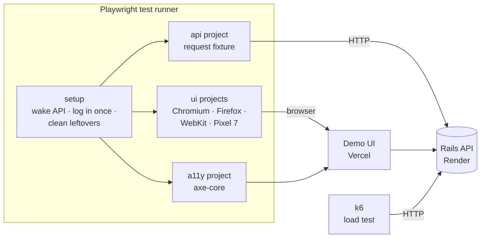
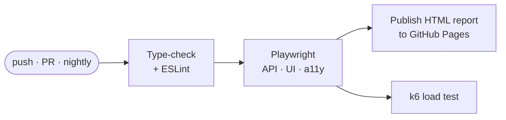

<div align="center">

# 🧪 Community Reservations: QA & Test Automation

**An end-to-end quality engineering project for a live booking system:<br>API, UI, accessibility, security, concurrency, and performance testing, plus the test plan, test cases, and defect reports behind them.**

[](https://github.com/nishithata/community-reservations-qa/actions/workflows/qa.yml)


[**Latest test report**](https://nishithata.github.io/community-reservations-qa/) · [**Test plan**](docs/TEST_PLAN.md) · [**Test cases**](docs/TEST_CASES.md) · [**Bug reports**](docs/BUG_REPORTS.md) · [**App under test**](https://community-reservations-api-web.vercel.app)

</div>

---

## What this project shows

| Skill | Where |
|---|---|
| **Test planning** | Scope, approach, risks, entry/exit criteria, severity model: [TEST_PLAN.md](docs/TEST_PLAN.md) |
| **Black-box test design** | Equivalence partitioning, boundary values, decision tables, state transitions, error guessing: [TEST_DESIGN.md](docs/TEST_DESIGN.md) |
| **Test cases & traceability** | ~75 cases mapped to 12 requirements: [TEST_CASES.md](docs/TEST_CASES.md) |
| **Manual & exploratory testing** | Manual cases and time-boxed charters: [EXPLORATORY_TESTING.md](docs/EXPLORATORY_TESTING.md) |
| **Defect reporting** | 7 reproducible defects with severity, priority, and fixes: [BUG_REPORTS.md](docs/BUG_REPORTS.md) |
| **API automation** | Contract, positive, negative, boundary, and authorization tests: [`tests/api`](tests/api) |
| **UI automation** | Page Object Model, cross-browser and mobile smoke: [`tests/ui`](tests/ui), [`tests/pages`](tests/pages) |
| **Security testing** | Forged/expired tokens, data isolation, mass assignment, XSS, SQL wildcards |
| **Concurrency testing** | Simultaneous bookings for one slot, exactly one must win |
| **Accessibility testing** | WCAG 2.1 AA audits with axe-core, keyboard operation: [`tests/a11y`](tests/a11y) |
| **Performance testing** | k6 ramp test with latency and error-rate thresholds: [`perf/load-test.js`](perf/load-test.js) |
| **CI/CD** | GitHub Actions on every push and nightly, HTML report published to GitHub Pages |

## The system under test

[Community Resource Reservations](https://github.com/nishithata/community-reservations-api) is a Ruby on Rails REST API with a JavaScript client: members book rooms and equipment, admins manage the catalog. Its key promise is that **a resource can never be double-booked**. This suite tests the **deployed** system:

| Layer | Host | URL |
|---|---|---|
| UI | Vercel | https://community-reservations-api-web.vercel.app |
| API | Render | https://community-reservations-api.onrender.com |
| Database | Neon (PostgreSQL) | (private) |

## Test architecture



**Design decisions**

- **Page Object Model** (`tests/pages/app.page.ts`) with accessible selectors (roles and labels), so tests read like user actions and double as a basic accessibility check.
- **Typed API client** (`tests/support/api-client.ts`) with one `expectApiError` helper that asserts the error contract on every negative test.
- **Live-environment safety:** dedicated QA accounts (the public demo account never gets test data), unique far-future slots, a cleanup fixture that cancels bookings even when a test fails, and a setup step that removes leftovers from crashed runs.
- **Rate-limit aware:** logs in once per run, separates API and UI accounts, and the client waits and retries on `429` like a well-behaved integration would.
- **Known issues stay visible:** tests annotate documented defects (e.g. BUG-001) in the report instead of hiding them.

## Running the tests

Requirements: Node.js 20+.

```bash
npm install
npx playwright install --with-deps   # browsers

npm test                 # everything
npm run test:api         # API only (no browser)
npm run test:ui          # UI on Chromium
npm run test:smoke       # @smoke tests on every browser
npm run test:a11y        # accessibility audits
npm run report           # open the HTML report

k6 run perf/load-test.js # performance (install k6 first)
```

Point the suite at another environment with environment variables:

```bash
API_URL=http://localhost:3000 UI_URL=http://localhost:8091 npm test
ADMIN_PASSWORD=... npm test   # also runs admin-only tests
```

## CI pipeline



Each run writes a results table to the job summary, uploads the HTML report, and keeps traces, screenshots, and videos of any failure for 14 days.

## Project structure

```
tests/
├── setup/auth.setup.ts      wake the API, log in once, clean leftovers
├── api/                     health · auth · resources · reservations
├── ui/                      browse · auth · booking · admin
├── a11y/                    axe audits, accessible names, keyboard
├── pages/app.page.ts        page object
└── support/                 env, typed API client, fixtures, test data
perf/load-test.js            k6 scenario and thresholds
docs/                        plan · design · cases · exploratory · bugs · report
.github/workflows/qa.yml     CI: static checks → tests → report → performance
```

## Author

**Nishitha Thatha Anil:** [GitHub](https://github.com/nishithata) · [LinkedIn](https://www.linkedin.com/in/nishitha-anil/)
