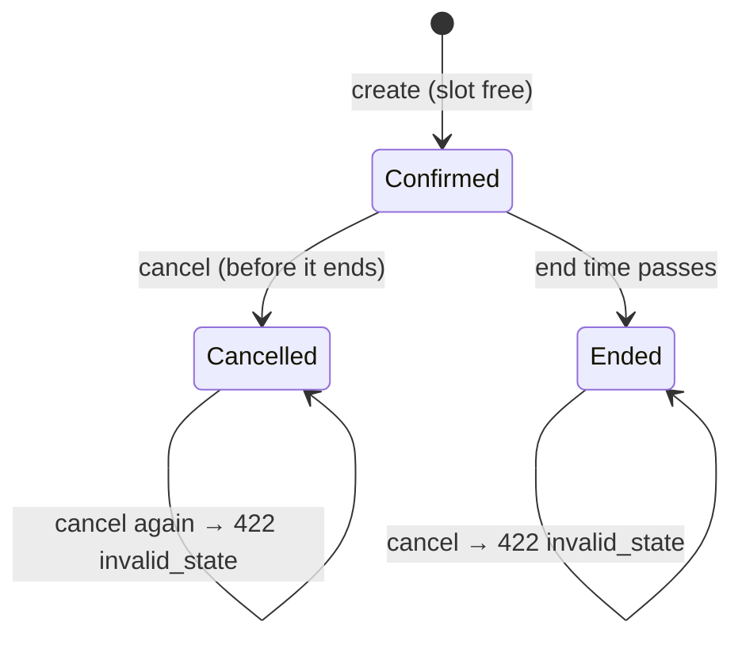

# Test Design Techniques

This suite is designed with classic **black-box** techniques: tests are derived from the specification (what the system should do), not from reading the code. Each section shows the technique, how it was applied here, and which tests implement it.

## Black-box vs. white-box testing

| | Black-box (this suite) | White-box |
|---|---|---|
| Basis | Requirements and observable behavior | Source code structure |
| Who | QA, testers, end users | Developers |
| Examples here | API and UI tests against the deployed system | The Rails app's own model and request tests (in the API repository) |
| Strength | Finds gaps between spec and behavior; independent of implementation | Finds untested branches and edge cases in code |

## 1. Equivalence partitioning

Split inputs into classes the system should treat the same way, then test one value per class.

**Resource category filter** (`TC-RES-003`, `TC-RES-004`):

| Partition | Representative values | Expected |
|---|---|---|
| Valid categories | `room`, `equipment`, `space`, `vehicle` | 200, only that category |
| Invalid category | `spaceship` | 400 `bad_request` |
| Absent | (no parameter) | 200, all categories |

**Login credentials** (`TC-AUTH-001` to `TC-AUTH-003`):

| Partition | Expected |
|---|---|
| Correct email + correct password | 200 with token |
| Correct email + wrong password | 401 "Invalid email or password" |
| Unknown email | 401 with the **same** message (no account enumeration) |

## 2. Boundary value analysis

Bugs cluster at the edges of ranges, so test just below, on, and just above each boundary.

**Reservation duration**, valid range 15 minutes to 8 hours (`TC-RSV-003`):

| Duration | Boundary | Expected |
|---|---|---|
| 14 min | below minimum | 422 |
| **15 min** | minimum | 201 |
| **8 h** | maximum | 201 |
| 8 h 1 min | above maximum | 422 |

**Page size**, `per_page` default 20, minimum 1, maximum 100 (`TC-RES-007`):

| Input | Expected `per_page` |
|---|---|
| `0` | 20 (default) |
| `1`, `2` | 1, 2 |
| `100` | 100 |
| `101`, `1000` | 100 (capped) |
| `abc` | 20 (default) |

**Time-range boundaries**: an end time equal to another booking's start time is a boundary of the overlap rule (see the decision table below).

## 3. Decision tables

List every combination of conditions and the expected action.

**Overlap detection** against an existing booking from 10:00 to 12:00 (`TC-RSV-010`). Intervals are half-open `[start, end)`.

| # | New booking | Starts before 12:00? | Ends after 10:00? | Overlaps? | Expected |
|---|---|---|---|---|---|
| 1 | 10:00-12:00 (identical) | yes | yes | yes | 409 |
| 2 | 09:30-10:30 | yes | yes | yes | 409 |
| 3 | 11:30-12:30 | yes | yes | yes | 409 |
| 4 | 10:30-11:30 (inside) | yes | yes | yes | 409 |
| 5 | 09:30-12:30 (surrounds) | yes | yes | yes | 409 |
| 6 | 09:00-10:00 (adjacent before) | yes | **no** | no | 201 |
| 7 | 12:00-13:00 (adjacent after) | **no** | yes | no | 201 |

**Authorization**: who may change the catalog (`TC-RES-020` to `TC-RES-022`):

| Action | Anonymous | Member | Admin |
|---|---|---|---|
| Create resource | 401 | 403 | 201 |
| Update resource | 401 | 403 | 200 |
| Delete resource | 401 | 403 | 204, or 409 if it has bookings |
| View another member's reservation | 401 | **404** (hidden, not 403) | 200 |
| Cancel another member's reservation | 401 | 404 | 200 |

## 4. State transition testing

A reservation moves through states; test every valid transition and attempt the invalid ones (`TC-RSV-020`, `TC-UI-020`).

| From | Event | To | Tested |
|---|---|---|---|
| (none) | create in a free slot | Confirmed | ✅ |
| (none) | create in a taken slot | (rejected, 409) | ✅ |
| Confirmed | cancel | Cancelled, slot freed | ✅ |
| Cancelled | cancel | 422 `invalid_state` | ✅ |
| Ended | cancel | 422 `invalid_state` | covered by the API's own tests (needs a past booking) |

## 5. Error guessing

Using experience to guess where developers commonly slip:

| Guess | Test |
|---|---|
| SQL wildcards (`%`, `_`) in search match everything | `TC-RES-006` |
| Mass assignment: the client sets `user_id`, `status`, or `role` | `TC-RSV-002`, `TC-AUTH-004` |
| Stored XSS through free-text notes | `TC-UI-022` |
| Malformed JSON crashes the server (500) | `TC-RSV-008` |
| Forged or expired tokens are accepted | `TC-AUTH-006` to `TC-AUTH-009` |
| A page number past the end causes an error | `TC-RES-009` |
| Two simultaneous requests both win the same slot | `TC-RSV-012` |

## 6. Manual testing

Automation covers regression; manual testing covers judgment calls automation can't make well: usability, visual layout, confusing wording, and unexpected combinations. Manual test cases are marked **Manual** in the [test case catalog](TEST_CASES.md), and exploratory sessions are recorded in [EXPLORATORY_TESTING.md](EXPLORATORY_TESTING.md).

## 7. A/B testing

A/B testing compares two variants of a feature with real users to see which performs better (for example, which booking form leads to more completed reservations). It is a **product experiment**, not a correctness test, and it needs:

1. Two variants behind a feature flag (e.g. a one-step vs. two-step booking form)
2. Random, sticky assignment of each visitor to a variant
3. Analytics events for the metric being compared (e.g. "booking completed")
4. Enough traffic for a statistically meaningful result

The demo has no variants or analytics, so A/B testing is **not applicable yet**. The QA responsibilities for an A/B test would be:

- Verify both variants work end to end (run the same UI suite against each variant)
- Verify assignment is random, roughly 50/50, and sticky across reloads
- Verify analytics events fire exactly once per action in both variants
- Verify the flag can be switched off instantly without breaking the page
